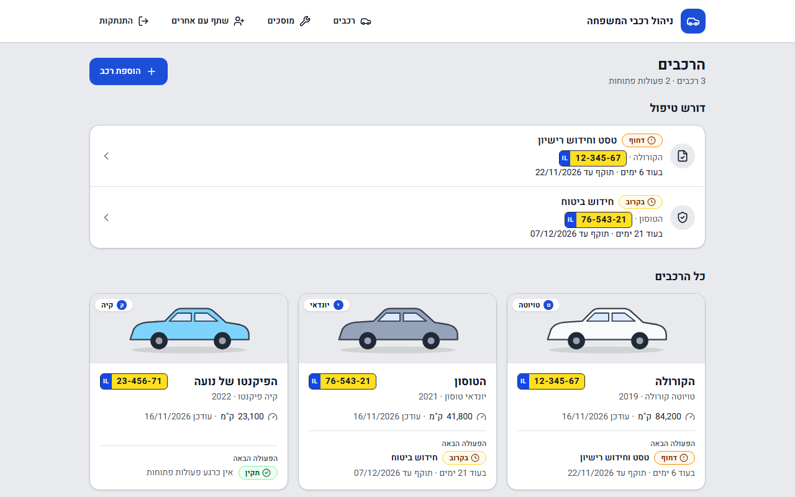
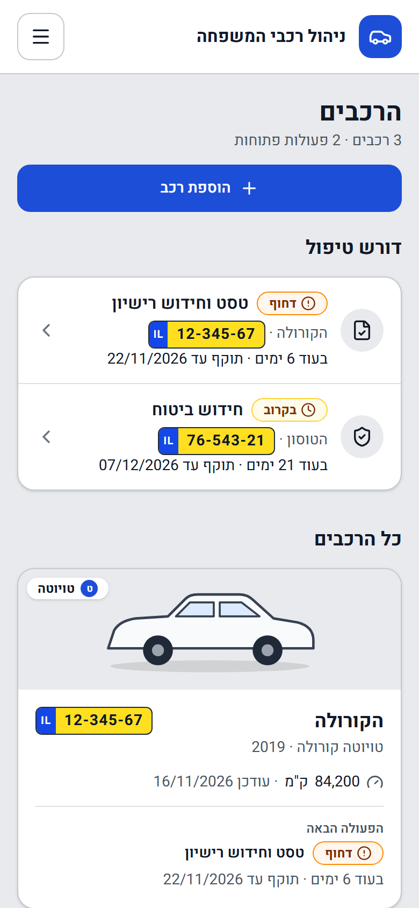
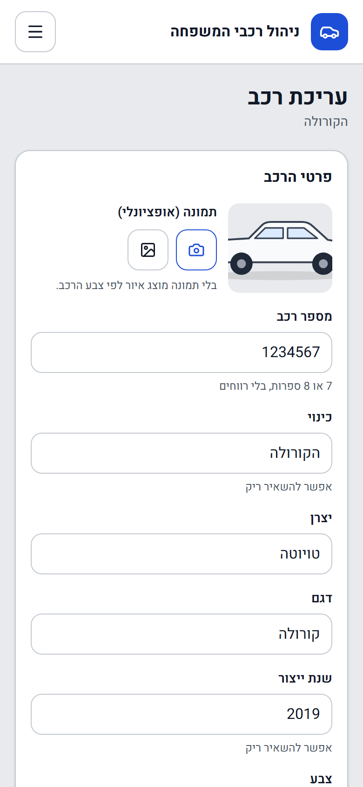
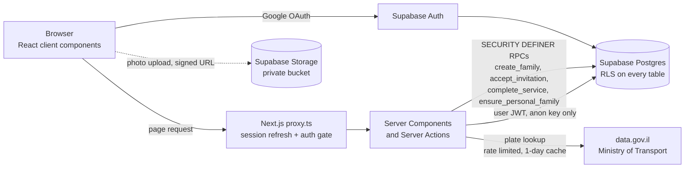

# Family Vehicle Manager

A mobile-first, Hebrew (RTL) web app that keeps track of a household's vehicles: license/test and insurance renewals, service by mileage, battery, tires and favorite garages. Type a plate number and the vehicle details are filled in from Israel's open Ministry of Transport data.

**Live demo: <https://family-vehicle-manager.vercel.app>** (sign in with Google; every new account starts with its own empty vehicle list)

| Dashboard (desktop) | Dashboard (mobile) | Edit vehicle (mobile) |
|---|---|---|
|  |  |  |

_Screenshots use seeded demo vehicles with made-up plates; no real user data. The UI is Hebrew and right-to-left._

## The problem

Cars in a household come with a pile of dates and numbers: the annual test and license renewal, insurance expiry, the next service at N km, when the battery and tires were last changed, which garage did what. They live in glove boxes, WhatsApp threads and memory, and they are easy to miss (an expired license means a fine).

## The solution

One place for all of it, with **clear alert levels** (overdue / urgent / soon / ok, shown with a label and icon, never color alone) and a "what needs attention" list on the dashboard. Adding a vehicle takes seconds because the app **looks the plate up in data.gov.il** (the Ministry of Transport's open dataset) and pre-fills make, model, year, color, fuel type and license expiry. A vehicle list can stay private, or be shared with family members through an email-bound invite link.

## Features

- **Plate lookup** from data.gov.il (no API key), with a one-day cache for successful answers, an 8 second timeout and a graceful manual fallback.
- **License/test and insurance** tracking with urgency levels, one-tap "mark as renewed" and a 30-day undo.
- **Service by mileage**: log a service, the next one is computed from the interval, mileage only moves forward. Estimates are labeled as estimates.
- **Battery and tires** (single date or per wheel, with a 4-wheel diagram), reminders after N months / K km, whichever comes first.
- **Garages**: shared list with call, Waze and Google Maps links, and a link from a service entry to a garage.
- **Photos** stored in a private Supabase Storage bucket, resized in the browser and served through short-lived signed URLs; a generic illustration tinted by the car's color when there is no photo.
- **Sharing**: invite family members by email-bound link (7 days, single use); admin/member roles; the last admin cannot be removed.
- **Personal first**: a new user gets a personal list automatically, with no setup screen. Sharing is opt-in, and accepting an invite replaces an empty personal list (never one that has vehicles).
- Hebrew RTL UI, 44px touch targets, keyboard and screen-reader friendly (axe checks in tests).

## Tech stack

| Area | Choice |
|---|---|
| Framework | Next.js 16 (App Router, Server Components, Server Actions, `proxy.ts`), React 19, TypeScript |
| Styling | Tailwind CSS v4, Heebo font, lucide icons |
| Backend | Supabase: Postgres with Row Level Security, Google OAuth, private Storage |
| Validation | zod (server side) |
| Hosting | Vercel, functions pinned to `fra1`; Supabase in `eu-central-1` (Frankfurt) |
| Tests | Vitest + Testing Library (+ axe), SQL tests on PGlite (in-process Postgres) |
| CI | GitHub Actions: typecheck, lint, unit tests, SQL tests, production build |

## Architecture



- The app only ever holds the **publishable key** plus the signed-in user's JWT. There is no `service_role` key anywhere, so **RLS is the real authorization layer**; the UI merely hides what the database would refuse.
- Reads in pages verify the JWT locally (`getClaims`) to avoid an Auth round trip. The proxy and every write call `getUser()` so a revoked session is rejected immediately.
- Operations that must be atomic or must cross RLS boundaries are **`SECURITY DEFINER` functions** with an empty `search_path`: creating a group, accepting an invitation, completing a service, renewing and undoing a renewal, editing service logs.

## Engineering highlights

- **Row Level Security with per-group isolation.** Every table is scoped by group membership through helper functions (`is_family_member`, `can_access_vehicle`, ...). Storage policies follow the same rule, so one group cannot read another group's photos by guessing a path.
- **Concurrency-safe RPCs.** `ensure_personal_family` and `accept_invitation` take a per-user **advisory lock** and are backed by a unique index (one membership per user), so a double click or two tabs cannot create two groups. Accepting an invite deletes only an empty solo group, inside the same transaction.
- **Invariants live in the database.** The last-admin rule is a trigger; one pending invite per email per group is a partial unique index; the service "next due" value is recomputed in SQL.
- **Rate limiting** on the plate lookup (20 requests/min/user) and manual refresh (10/min/user): a best-effort in-memory sliding window, documented as such.
- **Time zones.** "Today" is always the calendar date in `Asia/Jerusalem`, on the server and in SQL, so alerts do not flip at the wrong hour.
- **Tests**: 154 Vitest tests (alert logic, date handling, zod schemas, forms, modals, tire diagram, accessibility) and 150+ SQL assertions that run the real migrations on PGlite, including cross-group access attempts. All of it runs in CI on every PR.
- **Performance and region migration.** The database originally lived in Seoul, far from the Vercel functions and the Israeli users, so every page paid for several slow round trips (one Auth call plus 2-3 queries). Moving Supabase to Frankfurt (`eu-central-1`) and pinning the functions to `fra1` fixed most of it; verifying the JWT locally, fetching membership in a single query and running page queries in parallel trimmed the rest. Client JS per route is tracked with `scripts/route-js-size.mjs`.
- **Security headers**, strict `next` redirect sanitizing (no open redirects) and server-side filtering of every vehicle/photo action by group, in addition to RLS.

## Run it locally

Requirements: Node 22+, a Supabase project (free tier is fine) and a Google OAuth client.

```bash
git clone https://github.com/mandalaoui/family-vehicle-manager.git
cd family-vehicle-manager
npm install
cp .env.example .env.local   # fill in the two Supabase values, see below
npm run dev                  # http://localhost:3000
```

`.env.local` needs only:

| Variable | Value |
|---|---|
| `NEXT_PUBLIC_SUPABASE_URL` | your project URL (Project Settings, API) |
| `NEXT_PUBLIC_SUPABASE_PUBLISHABLE_KEY` | the publishable (anon) key. Never use the `service_role` key here |

The reminder and debug variables in `.env.example` are optional and off by default.

**Database.** In the Supabase SQL Editor, run the files in `supabase/migrations/` in this order:

1. `20261114120000_phase1_schema.sql`
2. `20261114130000_complete_service.sql`
3. `20261115100000_phase1_5.sql`
4. `20261116100000_merge_test_license.sql`
5. `20261117100000_phase2_hardening.sql`
6. `20261118100000_phase2_features.sql`
7. `20261119100000_personal_group.sql`

Then enable the Google provider under Authentication and add `http://localhost:3000/**` to the redirect URLs. The step-by-step Google Cloud / Supabase / Vercel setup is in [docs/dev-guide.he.md](docs/dev-guide.he.md) (Hebrew).

## Testing

```bash
npm test            # Vitest: logic, components, accessibility
npm run test:sql    # RLS + migrations on in-process Postgres (PGlite), no install needed
npm run check       # typecheck + lint + tests + SQL tests + production build (same as CI)
```

## Docs

Internal and development notes (mostly Hebrew) live in [`docs/`](docs/):

- [dev-guide.he.md](docs/dev-guide.he.md): full setup, product decisions, manual test checklist
- [runbook.md](docs/runbook.md): regions, environment variables, performance measurement, troubleshooting
- [phone-test-checklist.md](docs/phone-test-checklist.md): manual checks on a real phone
- [spec.md](docs/spec.md): the original task spec
- [reminders.md](docs/reminders.md): the email-reminder groundwork (off)
- [CHANGELOG.md](CHANGELOG.md): history by phase

## Roadmap

- **Phase D (planned): email reminders** before license, insurance and service dates. The pure logic, cron route and a draft schema exist but are switched off (`REMINDERS_ENABLED`), pending a data-layer review.
- Housekeeping: keep dependencies current and trim unused code as phases land.

## License

[MIT](LICENSE)

---

## תקציר בעברית

אפליקציית ווב בעברית (RTL) למעקב אחרי רכבים: טסט ורישוי, ביטוח, טיפולים לפי קילומטראז׳, מצבר, צמיגים ומוסכים. מזינים מספר רכב והפרטים נשלפים אוטומטית ממאגר הנתונים הפתוח של משרד התחבורה (data.gov.il). אפשר להשתמש ברשימה אישית, או להזמין בני משפחה בקישור אישי. הבידוד בין קבוצות נאכף במסד הנתונים (Row Level Security), והפרויקט נבדק בבדיקות יחידה ובבדיקות SQL ב־CI. מדריך ההקמה המלא בעברית: [docs/dev-guide.he.md](docs/dev-guide.he.md).
